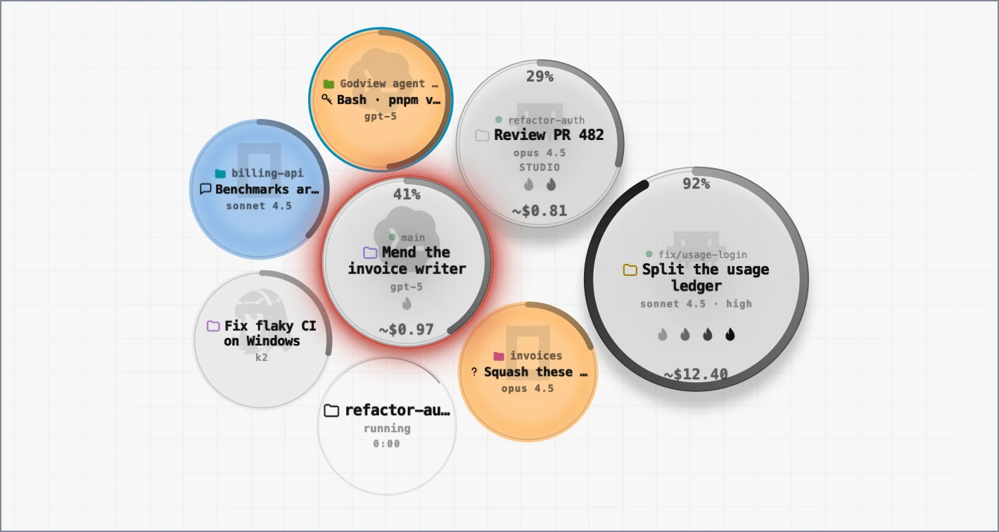
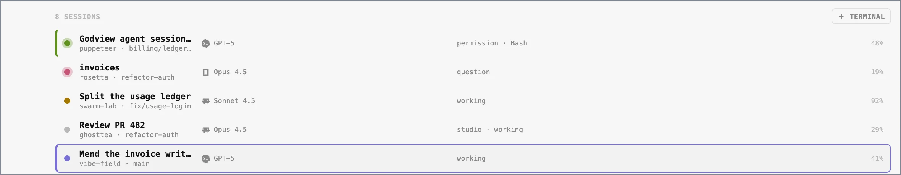
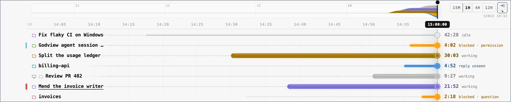
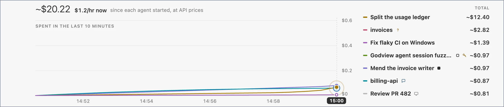
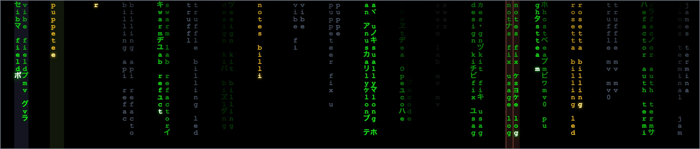

<p align="center">
  <a href="#start">
    <picture>
      <source media="(prefers-color-scheme: dark)" srcset=".github/readme/hero-dark.svg">
      
    </picture>
  </a>
</p>

<p align="center">
  <b>puppeteer is a TypeScript runtime for coding agents in their own terminals.</b><br>
  It launches Claude Code, Codex and the rest as the terminal apps they ship,<br>
  and gives your app one API for all of them: lifecycle, live state, prompts, workspaces.<br>
  State is read from each agent's hooks, protocols and logs, never from the screen.
</p>

<p align="center">
  <a href="#start"><b>Install</b></a>&nbsp;&nbsp;·&nbsp;
  <a href="docs/rfcs/004-layered-agent-runtime.md">Architecture</a>&nbsp;&nbsp;·&nbsp;
  <a href="docs/README.md">Docs</a>&nbsp;&nbsp;·&nbsp;
  <a href="docs/guides/adapting-an-agent.md">Add an agent</a>&nbsp;&nbsp;·&nbsp;
  <a href="https://www.npmjs.com/package/@vibefield/puppeteer-runtime">npm</a>
</p>

<p align="center">
  <a href="https://github.com/vibefield/puppeteer/actions/workflows/ci.yml"><picture><source media="(prefers-color-scheme: dark)" srcset="https://img.shields.io/github/actions/workflow/status/vibefield/puppeteer/ci.yml?branch=main&label=ci&style=flat-square&labelColor=212437&color=e6eafb"></picture></a>
  <a href="https://www.npmjs.com/package/@vibefield/puppeteer-runtime"><picture><source media="(prefers-color-scheme: dark)" srcset="https://img.shields.io/npm/v/%40vibefield%2Fpuppeteer-runtime?label=npm&style=flat-square&labelColor=212437&color=e6eafb"></picture></a>
  <a href="package.json"><picture><source media="(prefers-color-scheme: dark)" srcset="https://img.shields.io/node/v/%40vibefield%2Fpuppeteer-runtime?label=node&style=flat-square&labelColor=212437&color=e6eafb"></picture></a>
  <a href="LICENSE"><picture><source media="(prefers-color-scheme: dark)" srcset="https://img.shields.io/badge/license-MIT-e6eafb?style=flat-square&labelColor=212437"></picture></a>
</p>

<br>

<p align="center">
  <picture>
    <source media="(prefers-color-scheme: dark)" srcset=".github/readme/swarm-dark.webp">
    
  </picture>
</p>

<p align="center"><sub>The swarm, one of the views in <a href="packages/views"><code>@vibefield/puppeteer-views</code></a>, over the package's seeded lab world: Claude Code, Codex, OpenCode and Hermes sessions side by side. The light in a bubble is its state, the ring its context window, the flames its spend. A screenshot, not a mock.</sub></p>

## Start

<!-- x-release-please-start-version -->

```sh
pnpm add @vibefield/puppeteer-runtime@0.4.15 \
  @vibefield/puppeteer-builtin-providers@0.4.15
```

<!-- x-release-please-end -->

Node.js 22.18 or newer. You also need the agents themselves installed and signed in, and a terminal service to run them in: puppeteer asks yours for two things, through [`AgentHost`](#bring-your-own-terminal).

```ts
import { createBuiltinAgentRuntime } from '@vibefield/puppeteer-builtin-providers';

const runtime = createBuiltinAgentRuntime({ host, defaultCwd: process.cwd() });

const agent = await runtime.spawn({
  agent: 'claude',
  workspace: { mode: 'worktree', path: process.cwd() },
});
if ('error' in agent) throw new Error(agent.error.message);

agent.on('turn:*', ({ type }) => console.log(type));
agent.on('context-window:updated', ({ event }) => {
  console.log(`${event.usedTokens}/${event.capacityTokens} tokens`);
});

await agent.submitPrompt({ text: 'Review this repository' });
```

Claude Code opens in the terminal your host gave it, in its own git worktree, as the same TUI you get when you start it yourself. Your code hears `turn:started` and `turn:completed`, and can read `agent.status` at any time: `idle`, `working` or `blocked`. Change `'claude'` to `'codex'` and nothing else in this file changes.

## Many agents, one API

<p align="center">
  <picture>
    <source media="(prefers-color-scheme: dark)" srcset=".github/readme/roster-dark.svg">
    
  </picture>
</p>

Each agent is reached the way it offers: hooks for Claude Code, an app-server for Codex, a private backend for OpenCode, a gateway for Hermes, the session log for the ones that only write to disk. An adapter turns that into the same typed events, and the list is meant to grow: [adding an agent](docs/guides/adapting-an-agent.md) is one more adapter. The grid below is generated from [`support/agents.json`](support/agents.json): each cell names the exact release that passed.

## Agent support

<!-- agent-support:start -->
<table align="center">
  <tr>
    <td align="center" width="33%"><b>Antigravity</b><br><a href="packages/surface/vendors/antigravity/groundtruth.json"><picture><source media="(prefers-color-scheme: dark)" srcset="https://img.shields.io/badge/verified-1.1.20-e6eafb?style=flat-square&labelColor=212437"></picture></a></td>
    <td align="center" width="33%"><b>Claude Code</b><br><a href="packages/surface/vendors/claude/groundtruth.json"><picture><source media="(prefers-color-scheme: dark)" srcset="https://img.shields.io/badge/verified-2.1.311-e6eafb?style=flat-square&labelColor=212437"></picture></a></td>
    <td align="center" width="33%"><b>Codex</b><br><a href="packages/surface/vendors/codex/groundtruth.json"><picture><source media="(prefers-color-scheme: dark)" srcset="https://img.shields.io/badge/verified-0.166.0-e6eafb?style=flat-square&labelColor=212437"></picture></a></td>
  </tr>
  <tr>
    <td align="center" width="33%"><b>GitHub Copilot CLI</b><br><a href="packages/surface/vendors/copilot/groundtruth.json"><picture><source media="(prefers-color-scheme: dark)" srcset="https://img.shields.io/badge/verified-1.0.105-e6eafb?style=flat-square&labelColor=212437"></picture></a></td>
    <td align="center" width="33%"><b>Grok Build</b><br><a href="packages/surface/vendors/grok/groundtruth.json"><picture><source media="(prefers-color-scheme: dark)" srcset="https://img.shields.io/badge/verified-1.0.70-e6eafb?style=flat-square&labelColor=212437"></picture></a></td>
    <td align="center" width="33%"><b>Hermes Agent</b><br><a href="packages/surface/vendors/hermes/groundtruth.json"><picture><source media="(prefers-color-scheme: dark)" srcset="https://img.shields.io/badge/verified-0.21.5-e6eafb?style=flat-square&labelColor=212437"></picture></a></td>
  </tr>
  <tr>
    <td align="center" width="33%"><b>Kimi Code</b><br><a href="packages/surface/vendors/kimi/groundtruth.json"><picture><source media="(prefers-color-scheme: dark)" srcset="https://img.shields.io/badge/verified-2.4.1-e6eafb?style=flat-square&labelColor=212437"></picture></a></td>
    <td align="center" width="33%"><b>OpenCode</b><br><a href="packages/surface/vendors/opencode/groundtruth.json"><picture><source media="(prefers-color-scheme: dark)" srcset="https://img.shields.io/badge/verified-1.19.5-e6eafb?style=flat-square&labelColor=212437"></picture></a></td>
    <td align="center" width="33%"><b>Pi</b><br><a href="packages/surface/vendors/pi/groundtruth.json"><picture><source media="(prefers-color-scheme: dark)" srcset="https://img.shields.io/badge/verified-1.5.0-e6eafb?style=flat-square&labelColor=212437"></picture></a></td>
  </tr>
</table>
<!-- agent-support:end -->

<details>
<summary><b>What the badges mean</b></summary>

<br>

`verified` means the claim-addressable ASM v2+ model and exact artifacts passed the
full platform matrix, with the workflow/commit/model/replay/platform attestation
retained in the ledger. `legacy verified` preserves a previously supported baseline
that predates those gates; its versioned authoring model and digest are frozen, and it cannot
be changed or re-promoted without satisfying the current gates.
`baseline pending` is an executable candidate, not a support claim.

A staged candidate intentionally drives checked adapter projections and its
Imposter persona during review. That lets compatibility code and conformance run
before promotion; it does not change the supported-version badge, which follows
only `currentVersion` after the protected promotion gates pass.

Each badge links to the agent's stable runtime authority at its vendor root:
`groundtruth.json`. During review that document may already describe the staged
`candidateVersion` while the badge still reports the promoted `currentVersion`.
Versioned capture-derived documents remain authoring inputs, Git retains every
change to the canonical file, and
`pnpm surface:groundtruth:write` deterministically rebuilds both the canonical JSON
and a self-contained `groundtruth.html` explorer beside it.

Release detection is read-only. The adaptation workflow follows only allowlisted
redirects, bounds artifact streams before buffering, hashes the bytes, attaches
them to an already traced ASM v2+ candidate, runs fidelity-aware native replay
(byte-exact digesting, with schema validation only for type-preserving captures)
and drift classification, and may open a confined draft PR. A
separate protected workflow reacquires the bytes, runs credential-isolated
pinned-real tests on every required platform, and is the only path allowed to
update the support ledger and these badges.

</details>

## What you get

<table>
  <tr>
    <td valign="top">
      <picture><source media="(prefers-color-scheme: dark)" srcset=".github/readme/view-list-dark.webp"></picture><br>
      <b>Who needs you</b><br>
      Every session reduces to three states: idle, working, blocked. Blocked says why: a permission, a question, a failure. The list puts the blocked ones first.
    </td>
  </tr>
  <tr>
    <td valign="top">
      <picture><source media="(prefers-color-scheme: dark)" srcset=".github/readme/view-timeline-dark.webp"></picture><br>
      <b>The last hour, lane by lane</b><br>
      One lane per session: when it started, what it is doing now, and for how long. A session waiting on you shows how long it has waited.
    </td>
  </tr>
  <tr>
    <td valign="top">
      <picture><source media="(prefers-color-scheme: dark)" srcset=".github/readme/view-spend-dark.webp"></picture><br>
      <b>What it is costing</b><br>
      Token usage per session, priced at API rates where the agent reports enough to price it. An estimate, labelled as one, and blank where there is no price.
    </td>
  </tr>
  <tr>
    <td valign="top">
      <br>
      <b>And the rain</b><br>
      The same model, drawn for the pleasure of it. The views are React components over one contract, <a href="packages/view-sdk"><code>@vibefield/puppeteer-view-sdk</code></a>, so a view of your own gets the same rows.
    </td>
  </tr>
</table>

Also: four workspace modes (`direct`, `exclusive`, `worktree`, `copy`); `runtime.resume()` from one opaque value you store; [per-run briefings](docs/guides/run-briefings.md) that hand a run its MCP servers, allowed tools and instructions; and an append-only record of everything the runtime itself did.

## How it works

<p align="center">
  <picture>
    <source media="(prefers-color-scheme: dark)" srcset=".github/readme/path-dark.svg">
    
  </picture>
</p>

The agent owns its terminal; puppeteer owns the process around it. Nothing parses what the agent draws. An adapter decodes the agent's own signals and offers them as candidates; the runtime validates each against a schema, drops duplicates, gives it a sequence number and publishes it on that agent's private bus. An event the adapter does not recognise is kept as `adapter:native-event`, not dropped. Todos and plans stay with the agent: puppeteer has no task model. The layers and their rules are in [RFC 004](docs/rfcs/004-layered-agent-runtime.md).

### How an agent is verified

<p align="center">
  <picture>
    <source media="(prefers-color-scheme: dark)" srcset=".github/readme/proof-dark.svg">
    
  </picture>
</p>

These agents ship new versions often, so support is a claim about one exact release. Each agent has a single `groundtruth.json`, built from captures of the real program. The Imposter, one executable that can play any of them, is built from that file alone, so an adapter can be tested against it with no vendor software installed. A badge moves only when a protected workflow has run the real release on macOS, Linux and Windows. A scheduled job watches for the next one.

## Bring your own terminal

puppeteer has no terminal of its own. Your app lends it one through `AgentHost`, which is two methods: start a terminal, and write to one.

<details>
<summary><b>A whole host on node-pty</b></summary>

<br>

```ts
import type { AgentHost } from '@vibefield/puppeteer-core';
import { spawn, type IPty } from 'node-pty';

const terminals = new Map<string, IPty>();

export const host: AgentHost = {
  async spawnTerminal({ command, args, cwd, env, cols = 120, rows = 40 }) {
    const pty = spawn(command, args, { name: 'xterm-256color', cols, rows, cwd, env: { ...process.env, ...env } as Record<string, string> });
    const runtimeSessionId = `pty-${pty.pid}`;
    terminals.set(runtimeSessionId, pty);
    pty.onData((data) => process.stdout.write(data)); // the agent's own TUI, untouched
    return { runtimeSessionId };
  },
  async automateTerminal(runtimeSessionId, operation) {
    const pty = terminals.get(runtimeSessionId);
    if (!pty) return { accepted: false, reason: 'no such terminal' };
    if (operation.kind === 'interrupt') pty.write('\x03');
    else if (operation.kind === 'text') pty.write(operation.text);
    else pty.write(`\x1b[200~${operation.text}\x1b[201~${operation.submit ? '\r' : ''}`);
    return { accepted: true };
  },
};
```

Enough to try the snippet above. A real host also orders these writes against the person's own typing, and reports each process's exit through `runtime.handleProcessExit`.

</details>

<details>
<summary><b>Launch options for the built-in agents</b></summary>

<br>

`runtime.spawn()` creates one runtime-owned `Agent` for each provider spawn.
State, context-window, conversation, usage, environment, workspace, process,
notification, monitor, and adapter events share that agent's typed event bus:

```ts
import { createBuiltinAgentRuntime } from '@vibefield/puppeteer-builtin-providers';

const runtime = createBuiltinAgentRuntime({ host, defaultCwd: process.cwd() });
const onApproval = async () => 'denied' as const;

// Open provider catalog for generic pickers and monitoring UIs.
for (const provider of runtime.providers()) console.log(provider.id, provider.label);

const claude = await runtime.spawn({
  agent: 'claude',
  workspace: { mode: 'worktree', path: process.cwd() },
  agentOptions: {
    model: 'sonnet',
    permissionMode: 'plan',
  },
});
if ('error' in claude) throw new Error(claude.error.message);

claude.on('turn:*', ({ type }) => console.log(type));
claude.on('context-window:updated', ({ event }) => {
  console.log(`${event.usedTokens}/${event.capacityTokens}`);
});
claude.on('conversation:*', ({ event }) => console.log(event.text));
await claude.submitPrompt({ text: 'Review this repository' });

// Persist this envelope unchanged. Provider-specific state remains opaque.
const resumedClaude = await runtime.resume({ continuation: claude.info.continuation });
if ('error' in resumedClaude) throw new Error(resumedClaude.error.message);

const codex = await runtime.spawn({
  agent: 'codex',
  agentOptions: {
    model: 'gpt-5.6-sol',
    sandbox: 'read-only',
    approvalPolicy: 'never',
    onApproval,
  },
});
if ('error' in codex) throw new Error(codex.error.message);

const grok = await runtime.spawn({
  agent: 'grok',
  agentOptions: {
    model: 'grok-code-fast',
    permissionMode: 'plan',
    sandbox: 'workspace-write',
    onApproval,
  },
});
if ('error' in grok) throw new Error(grok.error.message);
```

Public envelope routes are namespaced (`turn:started`,
`context-window:updated`, `conversation:assistant-message`, `monitor:batch`,
and so on). The nested `event` is the normalized provider-neutral payload.
Adapters expose only this normalized stream and control operations; reducers
and projections live on the runtime-owned `Agent`.

Generic ACP sessions accept `clientCapabilities`, `onApproval`, and either a
per-session `connector` or the runtime's default `acpConnector`. Codex model and
safety options apply when creating a fresh thread; resumed threads retain their
existing configuration. Approval callbacks are process-lifetime policy seams;
when absent, structured adapters deny approval requests by default.

Launches and resumes also accept typed `mcpServers`, `allowTools`, and `instructions`
beside `modelSelection`. See [per-run briefings](docs/guides/run-briefings.md) for
provider capabilities, refusal behavior, credential lifetime, and the VibeField
sparks-door integration requirements.

</details>

<details>
<summary><b>Adopting a terminal the person already opened</b></summary>

<br>

When someone types `claude` in a shell your app gave them, that command can start as a managed session in the same terminal. The [spawn-through guide](docs/guides/spawn-through-hosts.md) covers the kit; the contract underneath it is this:

Terminal hosts discover adapter-declared commands with `launchProviders()`, then
submit provider-neutral shell intent. The selected adapter alone parses native
argv and environment semantics and authors the split-phase launch recipe:

```ts
const provider = runtime
  .launchProviders()
  .find((candidate) => candidate.nativeInvocation?.commands.some((command) => command.name === invokedAs));
if (!provider?.nativeInvocation) throw new Error('unsupported native invocation');

const environment = Object.fromEntries(
  provider.nativeInvocation.environmentVariables.flatMap((name) =>
    process.env[name] === undefined ? [] : [[name, process.env[name]!]],
  ),
);
const prepared = await runtime.prepareInvocation({
  providerId: provider.id,
  cwd: process.cwd(),
  argv: process.argv.slice(2),
  environment,
  implementation: { kind: 'native' },
});
if ('error' in prepared) throw new Error(prepared.error.message);

// Bind the pane before exec so no initial adapter events can race adoption.
const adopted = await runtime.adoptPrepared(prepared.preparationId, {
  runtimeSessionId: pane.id,
  processId: shimPid,
});
if ('error' in adopted) throw new Error(adopted.error.message);

const agent = runtime.agent(adopted.terminalSessionId)!;
agent.on('session:*', ({ type }) => console.log(type));

// The shim now chdirs, merges the env delta, and execs command + args exactly.
await shim.exec(prepared.launch);
```

Preparations use opaque ids, allow one terminal binding with idempotent retries,
and expire after 30 seconds by default (`preparationTtlMs` configures this).
`cancelPrepared` cleans up a failed or abandoned launch and is also idempotent.
The caller must report the
adopted vendor process's exit through `handleProcessExit` because the containing
shell/PTY remains alive. `processId` is correlation metadata for that monitor.
The launch environment can contain session bearer tokens and must not be logged
or persisted.

The configured built-in executable should resolve to the real vendor binary,
not the PATH shim, to avoid recursion. Generic ACP has no universal external
attachment transport and does not advertise native invocation. Callers should
fall through to the untouched command when the adapter rejects custom user
arguments. `createSession`, `prepareSession`, `sessionState`, and runtime-wide
`onEvent` remain low-level compatibility/composition surfaces; applications use
`spawn()`, `resume()`, and the returned `Agent`.

</details>

## Limits

- **Pre-1.0.** Releases are frequent and the contract still moves. Every package releases in lockstep, so pin one exact version.
- **A library, not an app.** There is no terminal and no window in the published packages. Godview and the adaptation workbench under `apps/` are private development tools.
- **Detail varies by agent.** An agent that only writes a log is seen less closely than one with hooks or a protocol; the roster's last column says which. Your code can answer an approval for Codex, Grok and ACP sessions. For the others the person answers in the agent's own TUI, and Pi cannot confirm that a prompt was received.
- **Support is per release.** A badge names the one version that passed. A newer one may work, and is not claimed until it is promoted.
- **The views were built for Godview.** They are published, but mounting them elsewhere means supplying the monitor model and its ports yourself.
- **No published benchmarks.**

## What is in the box

| Package | What it is |
| --- | --- |
| [`@vibefield/puppeteer-runtime`](packages/runtime) | Spawn, resume, the `Agent`, its event bus, monitor state, workspaces and records. No agent built in |
| [`@vibefield/puppeteer-builtin-providers`](packages/builtin-providers) | The runtime with every official adapter registered: one import to start |
| [`@vibefield/puppeteer-adapter-*`](packages) | One per agent: `antigravity`, `claude`, `codex`, `copilot`, `grok`, `hermes`, `kimi`, `opencode`, `pi`, and `acp` for any Agent Client Protocol agent |
| [`@vibefield/puppeteer-core`](packages/core) | Event schemas, session state and the host contract. No I/O |
| [`@vibefield/puppeteer-workspaces`](packages/workspaces) | The four workspace modes |
| [`@vibefield/puppeteer-record`](packages/record) | An append-only log of what the runtime did |
| [`@vibefield/puppeteer-native-observation`](packages/native-observation) | Bounded log tailing, shared by the adapters that read from disk |
| [`@vibefield/puppeteer-monitor`](packages/monitor), [`-react`](packages/react) | A transport-neutral store of monitor snapshots, and React hooks over it |
| [`@vibefield/puppeteer-view-sdk`](packages/view-sdk), [`-views`](packages/views) | The contract a monitor view is written to, and the views: swarm, list, timeline, spend, rain |
| [`@vibefield/puppeteer-surface`](packages/surface) | Each agent's captured evidence and its `groundtruth.json` |
| [`@vibefield/puppeteer-imposter`](packages/imposter) | `ai`, one executable that plays any supported agent from its ground truth |
| [`@vibefield/puppeteer-testing`](packages/testing) | The conformance suite every adapter passes |

<details>
<summary><b>Development</b></summary>

<br>

Repository setup, required checks, publishing, and recovery are documented in
[GitHub CI/CD](docs/github-cicd.md).

```sh
pnpm install
pnpm test
pnpm build
pnpm pack:check
```

To add a new coding agent or adapt a new upstream version, follow the
[end-to-end agent adaptation workflow](docs/guides/adapting-an-agent.md). It covers
native evidence, Surface modeling, Imposter personas and runflows,
normalization, conformance, runtime integration, and protected promotion.

Live adapter proofs are opt-in with `CLAUDE_NATIVE_TUI_LIVE=1`,
`CODEX_NATIVE_TUI_LIVE=1`, `GROK_LIVE=1`, `HERMES_LIVE=1`, `KIMI_LIVE=1`,
`OPENCODE_LIVE=1`, `COPILOT_LIVE=1`, `PI_LIVE=1`, or `ANTIGRAVITY_LIVE=1`
(Antigravity also needs `ANTIGRAVITY_DISPOSABLE_TERMS_APPROVED=1`).

</details>

<details>
<summary><b>Versioning and releases</b></summary>

<br>

All public Puppeteer packages release in lockstep. Internal `workspace:*`
dependencies are rewritten by pnpm to that exact version in published
tarballs. Applications should pin `@vibefield/puppeteer-runtime` exactly and
upgrade it as a deliberate integration event.

The initial `0.1.0` publication is bootstrapped from the tagged release commit:

```sh
pnpm release:publish
pnpm release:trust
```

`release:publish` verifies, builds, and publishes the public packages in
dependency order, skipping versions already present in the registry.
`release:trust` configures each package to trust `vibefield/puppeteer`'s
`release.yml` GitHub Actions workflow for `npm publish`; it requires npm 11.15
or newer, npm account 2FA, and an authenticated interactive npm session.

After configuring trust for `vibefield/puppeteer`, set the repository variable
`NPM_PUBLISH_ENABLED=true`. Release Please owns release PRs and tags, and the
Release workflow publishes through tokenless npm trusted publishing after CI
passes on the exact main commit. Provenance requires a public source repository
and is disabled while this repository is private. To retry a partial
publication, dispatch the workflow from `main` with the existing release tag:

```sh
gh workflow run release.yml --repo vibefield/puppeteer --ref main -f tag=vX.Y.Z
```

</details>

## License

Released under the [MIT License](LICENSE).

<br>

<p align="center">
  <a href="https://github.com/vibefield">
    <picture>
      <source media="(prefers-color-scheme: dark)" srcset=".github/readme/vibefield-dark.svg">
      
    </picture>
  </a>
</p>

<p align="center">
  <sub><a href="LICENSE">MIT</a> © 2026 James Yong. puppeteer is the agent runtime of <a href="https://github.com/vibefield/vibefield">VibeField</a>.</sub>
</p>
