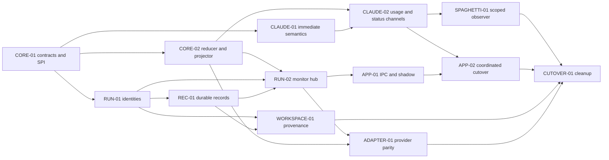

# RFC-001 Implementation Plan: Runtime Monitor V2

- **Status:** Superseded implementation history — monitor and layered-runtime cutovers complete
- **Created:** 2026-08-16
- **Last updated:** 2026-08-26
- **Companion RFC:** [`001-evidence-backed-runtime-observation.md`](../rfcs/001-evidence-backed-runtime-observation.md)
- **Primary target:** Godview beside native provider TUIs
- **Compatibility target:** one release with the v1 state and IPC bridges available

## Current implementation status

> **2026-08-26 layered-runtime cutover:** [`RFC-004`](../rfcs/004-layered-agent-runtime.md) is the current architecture. Monitoring is an invariant of every Agent, Runtime is provider-agnostic, concrete adapter composition lives in `@vibefield/puppeteer-builtin-providers`, adapters publish only unstamped candidates plus named capability services, and portable monitor/React packages own the presentation boundary. The baseline, feature-flag, dependency, and slice descriptions below are retained as dated implementation history.

> **2026-08-25 source cutover:** [`RFC-003`](../rfcs/003-native-observation-sources.md) retires the Spaghetti runtime dependency. References below to `SPAGHETTI-01`, scoped observers, SDK pins, shadow flags, and Spaghetti-owned live semantics are retained as implementation history, not current architecture. Claude now uses authenticated OTLP logs for settled request usage, transcript JSONL for conversation/history and usage fallback, and workflow journals for exact membership.

> **2026-08-25 architecture update:** adapter handles now publish only one
> normalized event stream. Every envelope has a top-level category route such as
> `turn:*`, `context-window:*`, or `monitor:*`; atomic monitor batches travel as
> `monitor:batch` on that same stream. The runtime creates one `Agent` per spawn,
> owns all reducers/projections there, and exposes typed observation through
> `agent.on(...)`. The separate `onMonitorBatch()` rail and adapter-owned state
> snapshots described in the original slice plan have been removed.

Stages A and B are implemented. The Stage C monitor code is implemented behind
opt-in flags and has passed local canary validation; monitor v2 is not the
default. Deterministic
Claude Imposter runs and the installed native Claude have exercised the native
Electron terminal, spawn-through shim, real Claude adapter, runtime
accumulator, v1/v2 shadow comparison, the Godview renderer, and strict terminal
removal. Independently, the local `SPAGHETTI-01` cutover is complete: the scoped
RFC-012D observer is Claude's sole transcript-derived source, and the legacy
tail, shadow/primary wrappers, and rollout flags have been removed. Typed team
and workflow facts can now enter the authoritative monitor projection; bounded
workflow artifact reads, typed human/meta message visibility, and broader
native team validation remain open.

The local team projection now reconciles canonical Spaghetti affiliations with
explicit native hook aliases without using display names as identities. It
keeps membership and activity provisionality separate, prefers the
root-affiliated team, separates the current member from peers, and joins each
peer actor's activity, usage/burn, context, observed model, and observed effort.
Deterministic adapter/core/renderer coverage is green. The native
Haiku/Sonnet-only team canary is implemented but could not run on 2026-08-24
because `claude auth status` reported `loggedIn: false` in the current shell.

| Slice                        | State                                                                                             | Remaining gate                                                                       |
| ---------------------------- | ------------------------------------------------------------------------------------------------- | ------------------------------------------------------------------------------------ |
| `CORE-01`, `CORE-02`         | Landed                                                                                            | Default-soak findings only                                                           |
| `RUN-01`, `REC-01`, `RUN-02` | Landed                                                                                            | Default-soak findings only                                                           |
| `CLAUDE-01`, `CLAUDE-02`     | Landed; all locally executable native matrix rows green with explicit Haiku/Sonnet guards         | Repeat in release cycles; team/workflow correlation remains under `SPAGHETTI-01`     |
| `WORKSPACE-01`               | Landed; workspace/record/runtime provenance soak green                                            | Repeat against release candidates                                                    |
| `APP-01`                     | Landed; shadow mode green in deterministic canaries                                               | Accumulate native canary evidence                                                    |
| `APP-02`                     | Landed behind `godviewMonitorV2`; native matrix and two independent local cycles green in Godview | Two canary release cycles                                                            |
| `ADAPTER-01`                 | Telemetry landed; native Codex/Grok/Kimi spot checks green                                        | Exact provider/version gates remain independent; OpenCode/Hermes unavailable locally |
| `SPAGHETTI-01`               | Scoped observer authoritative against sibling 0.7.0; legacy source and rollout wrappers removed   | Typed message visibility, bounded artifact API, and native team/workflow validation  |
| `CUTOVER-01`                 | Semantic-source cleanup landed; monitor/UI compatibility cleanup remains                          | Requires Stage D and downstream handoff fixtures                                     |

Latest local Stage C verification on 2026-08-18:

- On 2026-08-24, Claude's semantic rail cut over unconditionally to the local
  RFC-012D scoped observer. All three consumers declare the exact 0.7.0 edge,
  while the root override links the sibling workspace for rapid iteration. The
  adapter now reconstructs root assistant messages and resume replay from typed
  `MessageRevision` and `ContentBlockRevision` facts, so conversation behavior
  no longer depends on raw transcript records. User-prompt replay remains
  degraded until the typed message contract carries Claude's native human/meta
  visibility bit; known synthetic and compaction-summary forms are excluded.
  The legacy provider, raw
  transcript observer, shadow/primary wrappers, comparison callbacks, and two
  scoped rollout flags were deleted. Fake epoch/correction tests, the real
  sibling-native-addon bootstrap/live test, Claude driver resume tests, and the
  complete adapter/runtime suites pass.

- On 2026-08-23, Puppeteer linked the exact local Spaghetti 0.7.0 workspace
  through a root-only pnpm override and implemented the RFC-012D scoped
  observer behind `--puppeteer-spaghetti-scoped-shadow`. The adapter stages
  bootstrap/resync epochs atomically, handles overflow and retractions, follows
  descendants, maps questions/plans/tasks/effective state/actors/
  affiliations/usage/native markers, and keeps the legacy tail solely
  authoritative. Value-free shadow traces report family counts/digests,
  correction counts, hashed actor-set counts/digests, readiness, and the
  runtime-run join key. Fake-contract tests and a real
  sibling-native-addon bootstrap/live-question-resolution test pass. The
  Electron host declares the existing exact `0.5.16` package edge and externalizes
  it from its main bundle, allowing the root override to execute the sibling
  SDK from its own native-addon resolution context without changing the
  production pin. A real Godview spawn-through canary constrained to Haiku/low/
  Manual emitted a complete bootstrap barrier, live mode/model/usage batches,
  converged with the authoritative legacy projection, closed with zero discarded
  events, and passed the native reply/teardown smoke. Bounded artifact reads and
  released-package negotiation remain unavailable.

- `pnpm test` and `pnpm build` pass.
- Godview typechecks, tests, and bundles pass.
- Godview completes `ai --claude` spawn-through canaries with monotonic
  monitor revisions, no shadow mismatch, one clean end notification, and one
  terminal removal.
- Godview also passes with the real Claude executable deliberately configured
  as missing, proving the credential-free canary does not fall through to it.
- Installed Claude `2.1.234` is authenticated in the native host context. The
  credential probe remains read-only and no credential material is written to
  commands, traces, or repository files.
- The spawn-through canary now accepts and preserves explicit Claude model,
  effort, and permission-mode arguments and can assert all three from public
  monitor state before sending its first scripted prompt. The current matrix is
  restricted to explicitly selected `haiku` and `sonnet` models.
- Explicitly pinned native Haiku startup and response canaries pass. The trace
  observes the exact `claude-haiku-4-5-20251001` model card, 200,000-token
  context capacity and percentage, cumulative usage and response-boundary
  60-second burn rate, configured effort, working/idle/dead transitions, one
  end notification, and clean removal without a shadow mismatch.
- A pinned-Haiku `AskUserQuestion` choice canary passes end to end. The monitor
  exposes the prompt and all three choices, enters `blocked`, keeps the
  interaction distinct from permission approval, resolves after native TUI
  submission, returns to working/idle, and completes cleanly.
- Native evidence prompted three fixes now covered by regression tests: the
  `manual` launch alias and native `default` mode share the normalized display
  label `Manual`; shadow comparison tolerates bounded one-way projection lag
  but is strict at removal; and Claude's `PermissionRequest` record for
  `AskUserQuestion` no longer creates a false permission blocker.
- Pinned-Haiku task canaries pass in Godview. A stable native task ID
  progresses through `proposed`, `pending`, `in-progress`, and `completed`,
  with one created and one completed notification. Sparse updates that omit the
  description remain correlated by that ID.
- Claude 2.1.234 did not expose `TodoWrite` in the live session's tool catalog,
  even though the implementation string exists in the binary. Current Plan
  Mode instead writes Markdown and injects it into the `ExitPlanMode` hook.
  Puppeteer now projects bounded steps from that evidence while keeping the
  native plan path out of monitor plan state.
- An explicitly pinned Sonnet Plan Mode canary observes the exact
  `claude-sonnet-5` model card, two provisional plan steps, and the native
  ExitPlanMode approval blocker in real time. The harness then terminates
  without selecting an implementation mode; final state converges to
  `idle`/dead with no shadow mismatch. The hook proves approval is pending but
  does not expose the approval menu's individual choices.
- A controlled, explicitly pinned Haiku standard-subagent canary passes with
  the root and child models independently constrained to Haiku. One stable
  `Explore` actor becomes active, exposes live activity, exact
  `claude-haiku-4-5-20251001` model identity, 11,328 cumulative tokens, a
  nonzero 60-second burn rate, and 5.664% context usage, then stops. The final
  trace has no shadow mismatch.
- That canary exposed and fixed two replacement-order defects. Repeated child
  status snapshots now preserve each stable usage sample's first rate boundary
  instead of restamping old samples at the newest poll, and explicit
  `SubagentStop` evidence now seals the child against stale active status rows.
- A separate native run showed that Claude 2.1.234 can turn an `Agent` call with
  the optional `name` field into an `in_process_teammate` in an implicit team.
  The current monitor correctly retained the child actor and its activity but
  could not expose the team affiliation from the pinned legacy Spaghetti tail.
  This is accepted evidence of the `SPAGHETTI-01`/team-correlation gap, not a
  passing ordinary-subagent canary.
- An explicitly pinned Haiku `/compact` cancellation canary passes across a
  normal pre-command turn, the local command, and a normal post-command turn.
  Claude emits `PreCompact` and then reports that the short conversation cannot
  be compacted without emitting `PostCompact`. Puppeteer now treats the start
  as provisional, seals it at the next accepted prompt with
  `lastOutcome: unknown`, and emits no false completion notification. The
  final trace has no shadow mismatch and removes cleanly.
- Shadow comparison now excludes v2-only compacting activity from the legacy
  headline oracle. Legacy v1 has no compaction state; all facts represented by
  both reducers remain strict, including liveness and final removal.
- An explicitly pinned Haiku rail-loss canary closes the real loopback
  hook/status listener after the first accepted `Stop`, while preserving the
  Claude process and semantic observer. The monitor moves from `native-hooks`
  to `native-log`, keeps `alive: true` and lifecycle `ready`, qualifies the
  affected families as degraded, and observes the exact second assistant
  reply through the surviving rail. The trace has no shadow mismatch and the
  session ends/removes only during normal canary cleanup.
- A live configuration canary starts on exact `claude-sonnet-5` with low
  effort, observes `/effort max`, then observes `/model haiku` as exact
  `claude-haiku-4-5-20251001`. When Haiku's complete statusline omits effort,
  Puppeteer retracts the stale observed `max` value and falls back to the
  launch `low` value with `intent: configured`; both renderers label that
  distinction instead of presenting launch intent as effective evidence. The
  public projection now does the same for model and provider modes, retaining
  configured values next to the selected value and its intent. Canary gates
  state the expected intent explicitly: startup proves observed model and
  configured launch values, while the first prompt proves effective permission.
- Native Shift+Tab canaries observe Manual to Accept Edits and Manual to Plan
  transitions at the next `UserPromptSubmit` hook. The idle keystroke itself is
  not observable because Claude's statusline omits permission mode. The Plan
  run remained inside the allowed model set when Claude changed the effective
  pinned-Haiku session to Sonnet; Puppeteer reported the effective card rather
  than assuming the launch alias remained active.
- Structured-question canaries now cover single choice, `multiSelect: true`,
  and Claude's built-in free-form path. Prompt, per-question option labels,
  `allowMultiple`, and `allowFreeForm` are visible while blocked. Multi-select
  automation follows Claude 2.1.234's separate review/submit confirmation;
  free-form navigation opens the editor immediately and preserves the typed
  response. Multi-select and free-form paths pass in Godview, returning to
  working/idle with the exact sentinel reply. The
  harness now gates completion on removal of the matching question blocker, so
  a stale blocked projection cannot produce a false pass.
- The 2026-08-18 Spaghetti release audit found npm `latest` at 0.7.0, but that
  published package exports only `.` and `./react`, with no scoped-observation
  entry point. The local Spaghetti 0.7.0 development tree has substantial
  crate-private RFC-012D kernel work, while its own roadmap still marks Claude
  scope composition (`D2`) and SDK/Puppeteer migration (`D4`) not started.
  Puppeteer therefore remains exactly pinned to 0.5.16 and keeps team/workflow
  telemetry fail-closed until a released package satisfies section 8.12.
- A fresh, explicitly pinned Haiku session generated two synthetic long-form
  turns without tools or file reads, then emitted authoritative `PreCompact`
  and `PostCompact` boundaries for `/compact`. The monitor projected
  `lastOutcome: completed`, retracted the status producer's pre-compaction
  context snapshot, and reached strict teardown with no v1/v2 shadow mismatch.
  The canary now waits for Claude's input editor between scripted prompts and
  prints `SMOKE OK` only after final monitor removal/comparison.
- Spawn-through now preserves Claude's native `--setting-sources` selection
  through capability preflight, launch, and status-delegate discovery. An
  isolated project-only native Haiku canary excludes the user statusline and
  passes with the exact model, effort, mode, reply, and final convergence.
  Separate root-plus-child canaries require both user delegate marker files to
  grow, proving that Puppeteer observes and delegates rather than replacing
  either native status command. Delegate discovery mirrors Claude's cwd-only
  project/local settings roots and relocates user settings with
  `CLAUDE_CONFIG_DIR`; it does not inherit unrelated ancestor commands. The
  authenticated pane shim forwards only that resolved Claude-specific path, not
  the rest of the shell environment, so inline overrides reach discovery too.
- A native Haiku canary observes exactly two `Read` requests with distinct
  tool-call IDs and completed outcomes. A separate disposable-project canary
  uses Claude's official `PermissionRequest` hook to deny one harmless `Bash`
  request and observes the correlated `permission.resolved: denied`. The
  harness deliberately does not claim deterministic keyboard control over the
  current native permission modal.
- A `/clear` canary keeps one runtime run and terminal while changing the
  native-session ID, incrementing its revision, and recording
  `startSource: clear`. With the hook/status rail removed at a selected later
  occurrence, the next exact assistant reply arrives from the reattached
  native transcript, proving transcript rotation and semantic-observer restart
  rather than merely a hook-side rebind. The identity regression also composes
  native resume-picker selection with a later `/clear`, then rejects both the
  preview and pre-clear session IDs.
- Host termination, native `/exit`, and forced crash are independently covered.
  Real Claude clean/crash and Imposter host/crash runs expose the expected
  `runtime-terminated`, `completed`, or `crash` reason. Crash retains one
  failure blocker until explicit acknowledgement; every path then converges
  and removes exactly once.
- Native provider spot checks pass for Codex 0.147.0, Grok 1.0.5, and Kimi
  0.37.1. Codex matches its pinned contract; Grok and Kimi are newer than their
  pinned Surfaces, so those two runs are drift evidence rather than release
  gates. Kimi prompted a compatibility correction: `profile.bind` is
  configured alias/effort intent, `llm.request` is the applied model/effort,
  and input-only context is not compared with the legacy capacity-requiring
  shape. The rerun reports model `k3`, response-boundary burn, input occupancy
  with percentage unavailable, and no shadow mismatch. OpenCode and Hermes are
  not installed in this environment.
- Workspace, recorder, and runtime provenance suites pass together, including
  Git topology/rewrite cases, concurrent claims, privacy-safe persisted facts,
  retained dirty worktrees, failed finalization, and repeated disposal. Two
  fresh local canary cycles also pass in Godview with
  explicit Haiku/low/Plan configuration. These four local runs establish
  repeatability but are not counted as the two required canary release cycles.
- Godview's restart/corruption smoke again proves two fsynced restore
  generations, rejection of a deliberately truncated newest slot, fallback to
  the prior generation, and live PTY rebind. Its crash-like seed now cancels
  any pending checkpoint and seals Electron's ordinary quit interceptor before
  `app.exit(73)`, so the harness cannot erase the generations it is meant to
  test.

The next executable work is to repeat these gates on two release candidates
and run exact provider/version canaries as matching executables and credentials
become available. `SPAGHETTI-01` remains the only external code dependency;
Stage D must not start before the actual release-cycle evidence exists.

## 1. Purpose

This document turns RFC-001 into dependency-ordered implementation slices. It names the package boundaries, compatibility seams, feature flags, tests, and exit criteria needed to ship the three-state monitor without replacing any provider's native TUI.

The first production-worthy vertical slice is:

```text
provider side channels
  -> adapter events and atomic observation batches
  -> runtime-owned monitor accumulator
  -> one core status/activity projection
  -> full AgentMonitorState revisions
  -> Godview renders the idle | working | blocked result
```

The first vertical slice does not depend on the unreleased Spaghetti scoped-observer API. The current typed Claude transcript tail remains the compatibility semantic provider until the new observer passes its own shadow gates.

## 2. Definition of success

The refactor is complete when:

1. `AgentMonitorState` is the only live application state contract used by Godview.
2. `status` is exactly `idle | working | blocked`, and Godview renders the status and activity already projected by core.
3. All eleven runtime-observation checklist families are either populated from evidence or explicitly marked degraded/unsupported.
4. Claude observation continues to run beside the original TUI, preserves user statusline commands, and never parses screen text as semantic truth.
5. Runtime-run, native-session, terminal-session, actor, workspace, and external identities are not conflated.
6. Corrected and replaced semantic observations do not double count usage or leave vanished entities behind.
7. Clean termination publishes one end notification and removes the run; unexpected death retains a lightweight `blocked` failure monitor until acknowledgment/removal.
8. Workspace baseline/finalization and Puppeteer-owned actions are durable, idempotent, completeness-qualified, and usable by VibeField without Puppeteer making contribution claims.
9. The old serialized `SessionRuntimeState` path can be selected for one release, then is removed.

## 3. Historical baseline before cutover

The implementation must account for these current facts rather than assuming a greenfield system:

- `packages/core` is a zero-I/O package and owns `AgentEvent`, `AgentAdapterSession`, `AgentEventBus`, and the sequence-based `SessionRuntimeState` reducer.
- Every adapter depends on core. Runtime depends on core, all adapters, record, and workspaces. Godview depends on runtime and core. The safe dependency order is therefore core, adapters/runtime, then apps.
- Runtime currently keys live sessions by `runtimeSessionId`, mutates `AgentSessionInfo.sessionId` when a native ID changes, and restamps provider envelopes with a new local sequence.
- `closeManaged()` removes the session before publishing a final reduced state. There is no lightweight terminal monitor after process resources are released.
- Godview serializes `SessionRuntimeState` and has `classifyAgentStatus()`/`agentDetail()` on the rollback path.
- Claude combines hooks, root/child status channels, and Spaghetti's typed `observeSession()` stream. Questions, usage, effective state, actors, affiliations, plans, tasks, and conversation replay are projected without a second transcript parser.
- Claude `AskUserQuestion` is a typed pending interaction distinct from permission approval.
- Workspaces expose a short random `id` and best-effort final diff metadata, but not a normative repository baseline, isolation/interference evidence, or finalization completeness.
- Own-action JSONL records have no schema version, stable record ID, runtime-run identity, workspace identity, correction relation, or completeness. Injection records currently persist full prompt text.
- The Claude adapter, runtime, and Godview declare `@vibecook/spaghetti-sdk@0.7.0`; local development resolves that exact edge to the sibling workspace through the root override.

## 4. Execution decisions

These choices make the RFC implementable. They should be treated as part of the RFC ratification review.

### 4.1 Stable API versus version-locked monitor SPI

`@vibefield/puppeteer-core` will have two export surfaces:

- The package root exports stable application contracts: `AgentMonitorState`, `MonitorNotification`, `AgentMonitorHandle`, freshness helpers, and public identity types.
- `@vibefield/puppeteer-core/monitor-spi` exports version-locked adapter/runtime contracts: observation batches, source epochs, accumulator types, reducers, and projectors.

The SPI is published because adapters and runtime are separate packages. It is not an application API. All Puppeteer packages using it must remain on the exact same workspace/release version. Provider-native records never appear on either surface.

The private accumulator is private from product consumers, not physically hidden from the version-locked runtime package.

### 4.2 Identity names and ownership

- `runtimeRunId` is minted by runtime before provider lookup, workspace allocation, or process spawn.
- `runtimeEpoch` starts at 1. It changes only after a runtime-owned continuity break, not on Claude `/clear`, resume, transcript rotation, or observer resync.
- `terminalSessionId` replaces the routing concept currently called `runtimeSessionId`.
- `runtimeSessionId` remains a deprecated alias for one compatibility release.
- `nativeSession` is a correctable claim. Updating it never changes `runtimeRunId`.
- `creationRequestId` is optional for old callers and required for new Godview creation flows.
- Request IDs are capped at 256 UTF-8 bytes. External refs are capped at 32 entries per run, with 64-byte namespace/kind and 256-byte ID limits; Puppeteer validates and transports them but never interprets project/contributor semantics.
- In-memory requests share one in-flight promise, while an atomic durable creation-request registry preserves the request-to-run allocation across runtime-host restarts. A retry never spawns a second run merely because the original host disappeared.
- If a durable retry names a run that is not yet restored into the new host, runtime returns the same `runtimeRunId` plus `CREATION_REQUEST_RECOVERY_REQUIRED`; the caller may restore/adopt its known terminal. A terminal prior run returns its recorded terminal result. Creating genuinely new work requires a new request ID.
- A prepared session gets its `runtimeRunId` at prepare time; adoption later supplies `terminalSessionId` without creating a second run.

### 4.3 Status, blockers, and activity

Blocker display order is deterministic:

1. Failure.
2. Question.
3. Permission.

Within one kind, the oldest `since` value wins, then lexical blocker ID. All blockers remain in the array even when only the first is emphasized.

Working activity priority is:

1. Compaction.
2. Foreground tool.
3. Explicit reasoning.
4. Streaming/responding.
5. Child/delegation activity.
6. Starting.
7. Generic active turn.

An open plan or task is not activity. A provider with explicit start/end boundaries uses those boundaries. A pulse-only provider receives an initial 5-second working lease, refreshed by new compatible evidence and expired by a runtime-scheduled input. The lease is a runtime policy constant, not renderer time logic.

A new turn clears a recoverable turn-failure blocker. An unexpected process-death blocker clears only through explicit acknowledgment/removal.

### 4.4 Time, burn rate, and publication

- Core reducers never call `Date.now()` or install timers.
- Runtime owns an injected `MonitorClock` and scheduler.
- The initial operational burn window is 60 seconds. State carries `burnRateWindowMs`, so tuning the window does not require a schema change.
- The initial shared freshness policy marks evidence stale after 30 seconds; the pure classifier takes an injected clock and explicit policy override.
- Sample storage is time-bounded and capped at 256 samples per root/actor, retaining the one predecessor needed to calculate the window edge.
- Bootstrap installs a usage baseline and creates no rate.
- Downward corrections can lower `cumulativeTokens`; rate contribution from the correction is clamped to zero rather than rendered as negative burn.
- Ordinary metric/activity revisions are conflated and published at most once per 100 ms.
- Blocker entry/exit, process termination, native-session correction, and the readiness snapshot bypass ordinary coalescing.
- A monitor revision increments only when the public full state changes. Private duplicate evidence does not create UI churn.

### 4.5 Full-state fan-out

Monitor states are full replacements, not patches. Per-subscriber state delivery is latest-value conflated. Notifications use a bounded FIFO and stable IDs; subscriber overflow closes that notification stream with an explicit gap error so the consumer can resubscribe instead of silently missing events.

Public collection caps are deterministic: 64 blockers, 256 usage samples, 256 plan steps, 512 tasks, 256 subagents, 256 teammates, 128 workflows, 32 artifact refs and 256 actor-run refs per workflow, 256 worktrees, 64 questions per interaction, and 128 options per question. `AgentMonitorState.omitted` reports omitted counts. Blockers retain priority order; plan steps, questions, and question options retain provider order; entity collections put live entries first and then use stable identity. Usage/team totals are calculated before display rows are bounded, so truncating detail cannot change totals.

The runtime provides both:

- A race-free per-run `AgentMonitorHandle` matching RFC-001.
- Global host callbacks for Electron main-process fan-out, implemented by the same monitor hub and never by a second reducer.

### 4.6 Terminal retention

Process/session resources and public monitor retention are separate:

- `activeRunsByTerminalId` owns process/session/workspace resources.
- `runsById` owns identity and current monitor hubs.
- `terminalFailuresByRunId` retains only the final public state, session summary, and acknowledgment metadata after an unexpected death.

Clean completion publishes `session.ended`, synchronously fans out the final state/notification, then emits removal and deletes the monitor. Unexpected death releases all process/workspace resources but moves the small monitor entry to `terminalFailuresByRunId`.

Retention is bounded by acknowledgment plus a configurable host policy. Expiry, if enabled, emits removal; it never changes the failure to idle.

### 4.7 Persistence format and privacy

Own actions remain append-only JSONL for v2. Each new record has `schemaVersion`, `recordId`, `runtimeRunId`, `runtimeEpoch`, timestamps, quality/completeness, and relevant native/workspace refs.

The recorder lazily indexes stable record IDs before its first v2 append, so a replayed finalization does not normally append a duplicate across host restarts. Readers still deduplicate by `recordId`, making physical at-least-once lines logically idempotent under a crash or multi-process race. Legacy v1 lines remain readable.

Creation idempotency uses a small runtime-owned atomic sidecar registry with owner-only permissions and bounded claim documents. A fully written temporary claim is linked into its per-install-HMAC request path without overwrite; the winner defines `(request-key digest, compatible-payload fingerprint, runtimeRunId)`. Raw requests, provider options, and secrets are not persisted in the claim. This control-critical claim is separate from the append-only evidence log. If a caller requests idempotency and the claim cannot be made durable, creation fails before workspace or process side effects.

New injection records store prompt byte length and a stable injection/request ID by default, not prompt text or a guessable unkeyed digest. A per-install keyed digest or the body itself requires an explicit recording policy. Raw diffs, environment secrets, hook secrets, and arbitrary provider files remain excluded by default.

### 4.8 Feature flags

Flags live in one typed `RuntimeFeatureFlags` object supplied at runtime construction. Packages must not read scattered environment variables.

```ts
interface RuntimeFeatureFlags {
  agentMonitorStateV2: boolean;
  claudeSubagentStatusObservation: boolean;
  workspaceProvenanceV2: boolean;
}
```

`createAgentRuntime()` accepts `features?: Partial<RuntimeFeatureFlags>` and resolves omitted values to rollout defaults, so current callers do not break. Godview has one host-level `godviewMonitorV2` selection for renderer cutover. Shadow comparison is configured separately and cannot emit user notifications.

### 4.9 Resolution of `docs/archive/MONITOR.md` open questions

1. Burn rate initially uses a 60-second window. Canonical response boundaries and compatible low-latency samples carry their boundary type; sampling density is source-driven, not fake per-token streaming.
2. Claude transcript response/sidechain usage is canonical when actor identity is joinable. `subagentStatusLine` is a low-latency sample/cross-check. Hook `agent_id` proves actor activity/correlation but contributes no token count by itself.
3. Provider modes preserve raw open strings and may additionally carry a provider-specific normalized display value. There is no closed cross-vendor storage enum.
4. `AskUserQuestion` tool input is the low-latency structured-question signal. Ambient notification types alone never prove a question.
5. Worktree topology comes from runtime workspace/Git observation. Claude's behavior-replacing `WorktreeCreate` hook remains unregistered.
6. The new Spaghetti N-API/scoped tail is accepted only through the capability/epoch/replacement entry gate in `SPAGHETTI-01`; adapter code remains independent of daemon availability.

## 5. Target package and file layout

The exact names may move during review, but package ownership should not.

```text
packages/core/src/
  monitor/
    types.ts                 stable JSON-plain state/notification types
    freshness.ts             shared rendering qualifier
    team.ts                  distinct-run team aggregation helper
    internal-types.ts        accumulator/source bookkeeping
    reduce.ts                deterministic evidence reduction
    project.ts               sole status/activity/public projection
    notifications.ts         idempotent transition projection
    rate.ts                  corrected rolling-rate projection
    *.test.ts
  monitor-spi.ts             explicit version-locked subpath

packages/runtime/src/
  identity.ts                run allocation and creation idempotency
  creation-registry.ts       atomic request-to-run claims and run epochs
  monitor-clock.ts           injectable clock/scheduler boundary
  monitor-handle.ts          race-free bounded subscriptions
  monitor-hub.ts             per-run composition/publication
  runtime.ts                 lifecycle/resource integration

packages/adapter-claude/src/observation/
  semantic-provider.ts       provider interface and capability negotiation
  spaghetti-scoped.ts        authoritative RFC-012D epoch/replacement projection
  spaghetti-conversation.ts  typed root conversation and resume projection
  status-channel.ts          generic root/child status mux
  monitor-evidence.ts        Claude-local source join

packages/workspaces/src/
  provenance.ts              baseline/finalization/repository identity

packages/record/src/
  actions-v2.ts              schema-versioned own-action union
  recorder.ts                serialized, idempotent JSONL append
```

### 5.1 Adapter-to-runtime seam (updated final form)

`AgentAdapterBinding` is the low-level normalized producer. Atomic semantic
batches use the same event stream as every other adapter observation:

```ts
interface AgentAdapterBinding {
  events: {
    onCandidate(listener: (candidate: AdapterEventCandidate) => void): () => void;
  };
  services: {
    prompt: AgentPromptService;
    artifacts?: AgentArtifactService;
  };
}

type MonitorEvent = { type: 'monitor:batch'; batch: AdapterMonitorObservationBatch };
```

An adapter batch has source-local identity. Runtime attaches the managed run identity:

```ts
interface AdapterMonitorObservationBatch {
  schemaVersion: 1;
  batchId: string;
  producer: { id: string; epoch: string; sequence?: number; contractVersion?: string };
  phase: 'bootstrap' | 'live' | 'correction' | 'resync';
  observedAt: string;
  effectiveAt?: string;
  quality: EvidenceQuality;
  completeness: EvidenceCompleteness;
  provisional: boolean;
  readiness?: 'loading' | 'ready' | 'degraded';
  scope?: { nativeSessionId?: string; actorRunKey?: string };
  updates: MonitorFamilyUpdate[];
  sourceWatermarks: SourceWatermark[];
  evidence: EvidenceRef[];
  capabilities?: ObservationCapability[];
  coverage?: ObservationCoverage[];
}
```

Each update is a typed family-scoped `upsert`, `retract`, or complete/partial `replace`. A replacement affects only that family owned by the same producer epoch and scope; it cannot delete runtime or workspace evidence. Notifications are suppressed for bootstrap and replacement installation.

Runtime translates existing `AgentEventEnvelope`s into monitor inputs. Semantic observers use atomic batches when they need correction, retraction, or owned-set replacement. This permits gradual adapter migration without forcing revision semantics into every event.

### 5.2 Runtime API additions

```ts
interface AgentRuntime {
  spawn(options: CreateAgentSessionOptions): Promise<Agent | AgentSessionFailure>;
  agent(id: string): Agent | undefined;
  monitorState(runtimeRunId: string): AgentMonitorState | undefined;
  observeMonitor(runtimeRunId: string): AgentMonitorHandle;
  onMonitorState(listener: (state: AgentMonitorState) => void): () => void;
  onMonitorNotification(listener: (notice: MonitorNotification) => void): () => void;
  onMonitorRemoved(listener: (runtimeRunId: string) => void): () => void;
  acknowledgeFailureBlocker(runtimeRunId: string, blockerId: string): Promise<boolean>;
  readMonitorArtifact(
    runtimeRunId: string,
    artifactId: string,
    options?: { maxBytes?: number },
  ): Promise<MonitorArtifactReadResult>;

  /** @deprecated compatibility only */
  sessionState(terminalSessionId: string): SessionRuntimeState | undefined;
}

interface Agent {
  readonly state: SessionRuntimeState;
  readonly conversation: AgentConversationSnapshot;
  on(selector: AgentEventSelector, listener: AgentEventListener): () => void;
  submitPrompt(submission: PromptSubmission): Promise<PromptReceipt>;
}
```

Creation results and failures both carry `runtimeRunId`. `AgentSessionInfo` carries `runtimeRunId`, `runtimeEpoch`, `terminalSessionId`, `nativeSession`, and deprecated aliases.

`MonitorArtifactReadResult` is a JSON-plain success/denied/unavailable/too-large union. Successful content is UTF-8 text or base64 with an explicit media type. Reads resolve only an adapter-issued opaque `artifactId`; callers cannot submit a filesystem path. The initial default limit is 256 KiB with a 1 MiB hard host cap.

### 5.3 Compatibility event envelope

The diagnostic/compatibility event stream gains stable run and source identity without becoming the semantic replacement protocol:

```ts
interface RuntimeAgentEventEnvelope extends AgentEventEnvelope {
  eventId: string;
  runtimeRunId: string;
  runtimeEpoch: number;
  sequence: number; // delivery order within this runtime epoch
  actor?: ActorRunRef;
  sourceEventRef?: {
    namespace: string;
    eventId: string;
    revisionKey?: string;
    sourceGeneration?: number;
    cursorStart?: number;
    cursorEnd?: number;
  };
}
```

When a source supplies a stable cross-topology event ID, runtime derives its event ID from that source identity and retains the complete source reference. Otherwise runtime mints a stable ID at first ingestion. Restamping may assign a new delivery sequence; it may not erase or silently replace event identity.

## 6. Dependency graph



`CORE-02`, `RUN-01`, and `CLAUDE-01` can proceed in parallel after `CORE-01`. `WORKSPACE-01` can proceed alongside the app work. `SPAGHETTI-01` starts only when a released SDK satisfies its entry gate.

## 7. Slice summary

Estimates are engineering ranges for review, implementation, and focused tests; they are not calendar commitments.

| Slice          | Main outcome                                      | Depends on                  | Estimate        |
| -------------- | ------------------------------------------------- | --------------------------- | --------------- |
| `CORE-01`      | Stable monitor API and version-locked SPI         | RFC ratification            | 2-3 days        |
| `CORE-02`      | Deterministic reducer/projector/notifications     | `CORE-01`                   | 4-6 days        |
| `RUN-01`       | Stable run identity and idempotent creation       | `CORE-01`                   | 4-6 days        |
| `REC-01`       | Idempotent v2 own-action records                  | `RUN-01`                    | 3-5 days        |
| `RUN-02`       | Runtime monitor hub and truthful terminal flow    | `CORE-02`,`RUN-01`,`REC-01` | 5-7 days        |
| `CLAUDE-01`    | Questions, modes, plan/task/team/compaction edges | `CORE-01`                   | 4-6 days        |
| `CLAUDE-02`    | Root/child telemetry and typed transcript usage   | `CORE-02`,`CLAUDE-01`       | 4-7 days        |
| `WORKSPACE-01` | Baseline, finalization, isolation, interference   | `RUN-01`,`REC-01`           | 4-7 days        |
| `APP-01`       | New IPC in shadow mode                            | `RUN-02`                    | 2-4 days        |
| `APP-02`       | Godview uses the shared three-state monitor       | `APP-01`,`CLAUDE-02`        | 4-6 days        |
| `ADAPTER-01`   | Verified coverage in non-Claude adapters          | `CORE-02`,`RUN-02`          | 5-10 days total |
| `SPAGHETTI-01` | RFC-012D observer shadow and cutover              | `CLAUDE-02`, released SDK   | 5-8 days        |
| `CUTOVER-01`   | Defaults, compatibility removal, handoff fixtures | all required slices         | 2-3 days        |

The likely total is 48-78 engineer-days, with substantial parallelism. The critical path to an opt-in Claude Godview monitor is `CORE-01 -> CORE-02 -> RUN-02 -> APP-01 -> APP-02`, with `RUN-01`/`REC-01` and the two Claude slices joining that path.

## 8. Detailed implementation slices

### 8.1 `CORE-01`: contracts and package boundary

**Files**

- Add `packages/core/src/monitor/types.ts`, `freshness.ts`, `team.ts`, and `monitor-spi.ts`.
- Update `packages/core/src/index.ts` and `packages/core/package.json` exports/publish exports.
- Define the normalized `AgentAdapterSession` seam with `onEvent()` and optional `readMonitorArtifact()`.
- Add compile-time fixtures under `packages/core/src/monitor/`.

**Work**

1. Add branded/string identity aliases and `NativeSessionRef`, `ExternalRef`, and runtime-run metadata.
2. Add the exact public `AgentMonitorState`, blocker, notification, artifact reference/read-result, freshness, and handle contracts from RFC-001.
3. Define SPI source/batch/input types with explicit operation, family ownership, epoch, readiness phase, evidence quality, and stable IDs.
4. Keep public values JSON-plain: no `Map`, `Set`, `Date`, `Error`, class instance, provider record, or callable value.
5. Implement deterministic public collection caps and explicit omitted counts; never silently slice an array.
6. Add a shared freshness classifier and team aggregation signature. Neither helper may invent provider facts.
7. Document the SPI as version-locked and application-unsupported.

**Tests and exit gate**

- Public fixture survives `structuredClone()` and JSON round-trip.
- The status type accepts only three values.
- Unknown provider mode and effort strings round-trip.
- Oversized public collections sort deterministically, report exact omitted counts, and leave complete-set aggregates unchanged.
- Package source and publish subpath exports both resolve.
- `pnpm --filter @vibefield/puppeteer-core test`, `typecheck`, `pnpm packages:check`, and `pnpm pack:check` pass.
- No runtime or app behavior changes in this slice.

### 8.2 `CORE-02`: accumulator, projection, and notification semantics

**Files**

- Add `packages/core/src/monitor/internal-types.ts`, `reduce.ts`, `project.ts`, `notifications.ts`, and `rate.ts` with colocated tests.
- Add a compatibility translator from `AgentEventEnvelope` to monitor inputs.
- Add only the bounded event vocabulary needed by immediate adapters to `packages/core/src/events.ts`.

**Work**

1. Reduce runtime, semantic, and workspace evidence into separate private slices.
2. Deduplicate runtime inputs by stable event ID, semantic input by source/epoch/revision identity, and workspace records by stable record ID.
3. Implement family-scoped atomic replacement, corrections, retractions, and capability/readiness state.
4. Implement root and actor usage ledgers keyed by response/sample identity. Aggregate distinct actors before team/workflow affiliation.
5. Implement the 60-second non-negative rolling burn projection and bootstrap suppression.
6. Implement question, permission, and failure blockers with independent closure.
7. Implement the single status/activity projector using section 4.3 priorities.
8. Implement lease-expiry inputs; do not read wall time inside reducers.
9. Implement stable notification IDs and suppression during bootstrap/replacement.
10. Keep `SessionRuntimeState` behavior intact for compatibility; monitor state is projected separately.

**Tests and exit gate**

- Property tests cover deterministic replay, duplicates, arbitrary input order where source semantics allow it, correction, replacement, and affiliation arrival order.
- A downward usage correction changes totals but never creates a negative rate.
- A bootstrap total creates no rate or notification.
- An open task/plan alone projects idle.
- Concurrent question and permission blockers survive independent resolution.
- Blocker and activity ordering exactly match section 4.3.
- A semantic resync cannot erase process/workspace evidence.
- A complete replacement removes vanished semantic entities; partial coverage does not.
- Core exports one status/activity result consumed unchanged by fixture consumers.

### 8.3 `RUN-01`: runtime-run identity and idempotent creation

**Files**

- Add `packages/runtime/src/identity.ts`, `creation-registry.ts`, and tests.
- Update `packages/runtime/src/types.ts`, `runtime.ts`, preparation/adoption types, and relevant core envelopes.

**Work**

1. Allocate `runtimeRunId` and epoch 1 at request acceptance, before provider lookup and workspace acquisition.
2. Add `creationRequestId` and opaque `externalRefs` to creation/prepare options.
3. Return the allocated run ID in provider-not-found, workspace, spawn, preparation, and adoption failures.
4. Keep registries keyed separately by run and terminal routing identity.
5. Allocate one run during prepare and carry it through adopt; repeated compatible adoption remains idempotent.
6. Implement an in-flight request registry and a durable atomic request claim. The same request ID plus the same JSON-plain creation fingerprint returns the same live promise/result or the same persisted run allocation. Persist only per-install keyed fingerprints, never raw provider options. A conflicting fingerprint returns `CREATION_REQUEST_CONFLICT`.
7. Persist the request/run allocation before workspace or process side effects. If the new host has not restored the claimed run, return `CREATION_REQUEST_RECOVERY_REQUIRED` with the existing run ID rather than spawning again.
8. Reject idempotent creation with a clear error when identity-affecting provider options cannot be deterministically fingerprinted. Old callers without a request ID retain current behavior.
9. Add stable runtime event IDs and preserve upstream event/revision references when runtime assigns local delivery order.
10. Replace native-session mutation with a revisioned claim update. `/clear` or resume correction cannot change run identity.
11. When the host explicitly restores/adopts the same managed run after losing runtime continuity, increment and durably record `runtimeEpoch`, then restart delivery sequence at 1. Provider/session/observer rotation alone does not increment it.
12. Add `terminalSessionId` and deprecated alias getters/fields.

**Tests and exit gate**

- Two concurrent identical requests create one workspace/process.
- A conflicting request ID creates nothing new and fails explicitly.
- A retry after constructing a new runtime instance returns the same run allocation and never spawns until that run is restored or the caller supplies a new request ID.
- An unavailable durable claim store fails an idempotent request before workspace allocation.
- Workspace/spawn failure still returns a stable run ID; `REC-01` subsequently makes that allocation/failure part of the own-action evidence log.
- Prepare/adopt shares one run ID and is retry-safe.
- Host restoration preserves run identity, increments runtime epoch, and rejects old-epoch state/events.
- One native session resumed in two runtime runs stays joinable but distinct.
- Native-session rotation leaves run/terminal identities unchanged.
- Provider event IDs survive runtime restamping.

### 8.4 `REC-01`: durable Puppeteer-owned evidence

**Files**

- Add `packages/record/src/actions-v2.ts` and schema tests.
- Update `packages/record/src/recorder.ts`, `actions.ts`, and exports.
- Integrate record writes at runtime allocation and lifecycle boundaries.

**Work**

1. Add a v2 envelope and records for run allocation, workspace allocation, baseline, process spawn, native-session correlation/correction, process exit, workspace finalization, finalization failure, injection receipt, bounded artifact-read audit, and policy conflict.
2. Require a stable `recordId`; define deterministic IDs from run ID plus semantic action key, not append order.
3. Lazily read existing IDs before first v2 append and skip exact duplicates. Require all readers to deduplicate by ID as the final defense against at-least-once physical lines.
4. Record the runtime creation-registry claim ID/fingerprint reference in `run.allocated` evidence so the control decision and append-only audit trail can be reconciled.
5. Keep v1 records readable as a tagged legacy union.
6. Make recorder failure observable through diagnostics/readiness without failing the provider process. Durable creation safety does not depend on this best-effort evidence append because the runtime claim registry already won before side effects.
7. Redact injection bodies and unkeyed content digests by default; add explicit persistence policy for a per-install keyed digest or body.
8. Record effective/observed timestamps, evidence quality, and completeness independently.

**Tests and exit gate**

- Repeating finalization across a recorder restart appends one v2 record.
- A run-allocation record matches the winning runtime creation claim, and repeated record writes remain logically idempotent.
- Mixed v1/v2 JSONL reads successfully.
- Default records contain no prompt body, raw diff, token, environment dump, or credential-bearing remote URL.
- A failed write reports degradation but does not reject prompt submission or process cleanup.

### 8.5 `RUN-02`: monitor hub, clocks, fan-out, and terminal flow

**Files**

- Add `packages/runtime/src/monitor-clock.ts`, `monitor-handle.ts`, and `monitor-hub.ts` with tests.
- Refactor `packages/runtime/src/runtime.ts` and `types.ts`.

**Work**

1. Create one monitor hub per run before workspace/provider evidence arrives.
2. Feed it allocation, namespaced `AgentEventEnvelope`s (including `monitor:batch`), Git/workspace observations, prompt receipts, and actual host process exit.
3. Preserve the v1 session reducer in parallel behind `agentMonitorStateV2`.
4. Add readiness: subscribers attach first, the hub installs bootstrap evidence, and `ready` resolves to the first complete public snapshot.
5. Implement full-state revisions, latest-state conflation, bounded notifications, and global host callbacks.
6. Use the injected scheduler for rate aging, family freshness publication, and working-lease expiry.
7. On host-reported process exit, reduce and publish the real exit before resource removal.
8. On clean end, publish the final notification/state then removal. On unexpected death, dispose resources/finalize workspace and retain a failure monitor.
9. Add idempotent `acknowledgeFailureBlocker()`; reject attempts to acknowledge question/permission blockers.
10. Route bounded opaque artifact reads to the owning adapter, enforce the runtime hard cap before delegation, and audit metadata without content.
11. Treat observer/control rail loss as family degradation, never `process.exited`.
12. Keep `sessionState()` and existing `onEvent()` for compatibility/diagnostics.

**Tests and exit gate**

- The subscribe/drain/ready algorithm cannot miss the first state under adversarial scheduling.
- Two consumers share one source observation and receive independently ordered full states.
- Slow state consumers see the latest full replacement; notification overflow is explicit.
- Publication revisions are strictly ordered by `(runtimeEpoch, revision)`.
- Clean exit callback order is final state, end notification, removal.
- Crash callback order is failure state/notification, resource cleanup, retained monitor; acknowledgment then removal.
- Fake rail failure leaves `alive: true` and degrades only owned families.
- Artifact reads reject unknown/expired IDs and oversize limits before adapter access; successful reads generate metadata-only audit input.
- Existing runtime tests pass with the flag disabled.

### 8.6 `CLAUDE-01`: immediate hook semantics

**Files**

- Update `packages/adapter-claude/src/normalizer.ts`, `driver.ts`, generated registry inputs, and fixtures/tests.
- Add focused parsing helpers rather than provider conditionals in runtime/core.

**Work**

1. Preserve `permission_mode`, `effort`, provider version, `agent_id`, and `agent_type` from every supported hook envelope.
2. Add configured intent separately from observed effective model/effort/modes.
3. Normalize `AskUserQuestion` input into typed provisional question observations, including labels, descriptions, multi-select, and free-form allowance. Continue emitting its generic tool lifecycle for diagnostics.
4. Resolve/supersede/cancel a question only from matching result/semantic evidence or a trustworthy owning-turn boundary; never from terminal text disappearance.
5. Map `TodoWrite` and the plan Markdown injected into `ExitPlanMode` to provisional plan snapshots; map task/team fields without treating pre-transition hooks as committed state. Native plan paths do not enter monitor plan state.
6. Map `PreCompact`/`PostCompact`, `TeammateIdle`, subagent start/stop, cwd, and verified mode changes.
7. Add an observation-poll hint after relevant hooks.
8. Add a per-prompt collision-safe counter to fallback tool IDs.
9. Make a legitimate `session.started` after `/clear` rebind native identity instead of leaving the reducer terminal.
10. Preserve permission absence-closure at a trustworthy stop boundary and add the outlived-turn diagnostic.
11. Continue to omit Claude's behavior-replacing `WorktreeCreate` hook from registration.

**Tests and exit gate**

- Captured and synthetic `AskUserQuestion` payloads preserve every option and lifecycle outcome.
- Permission and question can coexist and close independently.
- Raw unknown modes/effort values survive.
- Pre-transition task/team events remain provisional until confirmation.
- Repeated same-name tools in one prompt get distinct IDs.
- `/clear` keeps the same live run and terminal while changing native-session claim.
- Hook bridge loss degrades observation without ending the process.

### 8.7 `CLAUDE-02`: root/child metrics and semantic provider boundary

**Files**

- Refactor the former status-line module and launch settings into
  `packages/adapter-claude/src/observation/status-channel.ts`, a generic root/child status channel.
- Add `semantic-provider.ts`, `spaghetti-scoped.ts`, `spaghetti-conversation.ts`, and `monitor-evidence.ts`.
- Update preparation/settings/forwarder generation and tests.

**Work**

1. Preserve provider `used_percentage` directly, with `percentageSource: 'provider'`; derive only when the percentage is absent and compatible counts exist.
2. Capture root model card ID/display name, effort, context, usage sample, and provider modes where the payload/version exposes them.
3. Add `subagentStatusLine` observation with stable child/task correlation when supplied.
4. Refactor forwarding so Puppeteer observes and then delegates both root and child payloads to any user-configured commands. One delegate's failure must not stop the other path.
5. Use typed RFC-012D message, content-block, usage, and actor facts to project conversation and response usage. Do not add a second JSON transcript parser.
6. Key canonical usage by response/actor identity and use root/child statusline values only as low-latency compatible samples/cross-checks.
7. Mark history replay as bootstrap so it sets a baseline without burn spikes or toasts.
8. Keep one `SemanticObservationProvider`: `SpaghettiScopedObservationProvider` is the default and sole transcript-derived source; unsupported artifact reads remain explicit.
9. Keep actor/team/workflow attribution unknown unless a verified native identifier joins it.
10. Keep the exact 0.7.0 Spaghetti dependency edge aligned across the adapter, runtime, and Godview; the local root override may resolve it to the sibling workspace.

**Tests and exit gate**

- Root and child status fixtures parse supported versions and retain unknown fields only in private/native evidence.
- Mid-session model/effort/mode changes update at the first observed boundary.
- Provider percentage wins over a locally calculated value.
- Transcript replay, live append, rewrite/correction, and sidechain usage do not double count.
- A downward correction changes the total and produces no negative rate.
- Existing user root and child commands still receive their original payload and exit behavior.
- No screen parsing, second model process, behavior-replacing hook, or direct renderer file access is introduced.

### 8.8 `WORKSPACE-01`: provenance and contribution evidence

**Files**

- Add `packages/workspaces/src/provenance.ts` and tests.
- Extend `workspace.ts`, `git.ts`, runtime workspace integration, and record v2 actions.

**Work**

1. Replace the short internal workspace ID with a durable `workspaceInstanceId`; retain `id` as a compatibility alias.
2. Resolve canonical worktree and common Git directory identity. Authorized local APIs may expose canonical paths; durable/default records use a per-install keyed repository digest and never an unredacted remote URL.
3. Capture baseline before provider spawn: HEAD/ref, dirty/index/worktree summaries/fingerprints, allocation mode, isolation quality, known concurrent claims, timestamps, and completeness.
4. Capture final HEAD/ref, dirty summaries/fingerprints, reachable commit range, files/stat summaries allowed by policy, interference/conflict evidence, and finalization outcome.
5. Classify isolation as managed-isolated, cooperative-exclusive, shared, or unknown. Direct mode must not claim exclusivity.
6. Detect evidence changes inconsistent with the managed run where feasible; record the evidence and lower quality instead of inventing authorship.
7. Finalize exactly once on clean exit, crash, cancellation, preparation failure after allocation, and runtime disposal.
8. Expose evidence records for VibeField joins, not contribution percentages.

**Tests and exit gate**

- Clean, initially dirty, no-commit, committed, rebased/squashed, detached-HEAD, deleted-branch, retained-worktree, and non-Git cases are representable.
- Initial dirty files are not described as newly produced work.
- Shared/concurrent/external modification lowers quality.
- Normal and abnormal paths produce one complete/partial/failed finalization record.
- Default persistence contains summaries/hashes, not raw diffs or credentials.

### 8.9 `APP-01`: monitor IPC and shadow comparison

**Files**

- Add v2 messages to both app `protocol.ts`, preload bridges, main-process fan-out, and tests.
- Add one shared shadow comparator outside renderer components.

**Work**

1. Send JSON-plain full `AgentMonitorState`, `MonitorNotification`, and monitor-removal messages.
2. Include both `runtimeRunId` and `terminalSessionId` in the host message wrapper so tab routing never becomes semantic identity.
3. Start a monitor handle before installing the first snapshot and enforce epoch/revision ordering in main.
4. Keep the current v1 renderer path as default.
5. In shadow mode, compare v1 and v2 only for facts both contracts can express. Record classified mismatches; do not toast shadow notifications.
6. Add acknowledgment IPC for failure blockers only.
7. Add explicit user-initiated bounded artifact-read IPC accepting only `(runtimeRunId, artifactId, maxBytes)`. Never prefetch artifacts or accept native paths from the renderer.
8. Keep hook secrets, transcript paths, private artifact locators, and accumulator state out of IPC.

**Tests and exit gate**

- JSON round-trip and IPC contract tests pass in Godview.
- An out-of-order/duplicate state is ignored by epoch/revision.
- Reconnect installs one current full state without replaying old toasts.
- Removal targets a run and its terminal mapping deterministically.
- Artifact IPC rejects unknown IDs, paths, oversize requests, and unsupported families without revealing private locators.
- v1 behavior remains unchanged when flags are off.

### 8.10 `APP-02`: Godview cutover

**Files**

- Refactor Godview monitor hooks/components.
- Delete the legacy serializer and app-local classification/detail helpers after the rollback bridge is isolated.

**Work**

1. Render `state.status`, `statusSince`, `activity`, and blockers directly.
2. Render question options distinctly from permission and failure details.
3. Add freshness-qualified usage/rate, context, model, effort, separate modes, plans/tasks, actors, teams, workflows, compaction, and environment detail.
4. Render unsupported, degraded, stale, and absent as qualifiers, never as zero or a fourth status.
5. Drive toasts/feed only from `MonitorNotification`.
6. Use the shared distinct-run team aggregator; do not add subagent breakdown to the already inclusive root total.
7. Keep native TUI panes as the place where users answer/approve unless a provider exposes an explicit host-control operation.
8. Switch the renderer in one coordinated slice so there is no period with two product status definitions.
9. Retain the isolated v1 bridge behind `godviewMonitorV2=false` for one release.

**Tests and exit gate**

- Monitor fixtures produce the projected headline status/activity without app-local reclassification.
- UI covers simultaneous blockers, question choices, child usage, team aggregation, stale families, unsupported families, and dead failure retention.
- A plan/task at rest does not animate as working.
- Clean end leaves the board; crash remains blocked until acknowledgment/removal.
- App code no longer imports `SessionRuntimeState` outside the isolated rollback bridge.
- Godview typecheck, unit tests, bundle, and smoke tests pass.

### 8.11 `ADAPTER-01`: verified non-Claude coverage

This is an epic split into one provider per PR. Every provider publishes a capability matrix and may report unsupported families. It must not infer parity.

**Codex**

- Preserve current authoritative context and model reroute behavior.
- Verify cumulative `tokenUsage.total` semantics against captures before mapping burn; retain `last` as context pressure.
- Map verified plan items, settings effort/approval/sandbox modes, collaboration child threads, and compaction lifecycle.
- Remove adapter/control-channel-close events that falsely claim host process exit.

**Grok**

- Keep `signals.json` context/model as context, not billed burn.
- Map verified subagent and compaction update lifecycles.
- Map workflow/goal updates only after fixtures establish stable identity/replacement semantics.
- Remove attach/control failure as fake process death.

**Kimi**

- Map typed `usage.record`, plan revision/mode, permission mode, compaction begin/complete/cancel, and existing task/subagent lifecycles.
- Preserve unknown future fields and verify whether usage is response, request, or cumulative before choosing the reducer input.

**ACP, OpenCode, and Hermes**

- Map only protocol-verified context, usage, model, mode, task, actor, and compaction facts.
- A control transport ending degrades its families; only the host reports process exit.

**Exit gate for each provider**

- Capability/readiness fixtures declare every checklist family supported, degraded, or unsupported.
- Bootstrap/replay causes no notifications or rate spike.
- Rail loss keeps the host process alive.
- Unknown values survive without crashing or becoming false zeros.
- Provider focused tests and shared monitor conformance pass.

### 8.12 `SPAGHETTI-01`: RFC-012D scoped observer

**Entry gate**

Local development may cut over against the exact sibling workspace package once
its SDK/N-API contract and behavioral fixtures provide:

- Contract/capability negotiation before source access.
- Session-scoped event and readiness streams.
- Scope epochs, overflow/resync control, and atomic replacement support.
- Stable semantic revision/native evidence identity.
- Explicit artifact availability and bounded reads when supported.

**Work**

1. Use `SpaghettiScopedObservationProvider` as Claude's unconditional transcript-derived source.
2. Fail the semantic rail closed with explicit degraded coverage when attachment is incompatible; hooks and the TUI remain alive, with no raw-transcript fallback.
3. Watch before initial scan, drain through readiness, stage resync epochs, and atomically install full family replacements.
4. Preserve semantic revision/evidence refs in the private accumulator.
5. Convert records to provider-neutral adapter batches; never leak Spaghetti records across the adapter boundary.
6. Reconstruct root conversation and resume replay from typed message/content-block facts while retaining child text under its actor; declare user-prompt visibility degraded until the contract carries the native human/meta classification.
7. Remove the legacy provider, raw transcript watcher, shadow/primary wrappers, comparison callbacks, and rollout flags.
8. Enforce bounded artifact families, sizes, media types, and audit records when the scoped artifact API lands; return explicit unavailable results until then.

**Tests and exit gate**

- Contract incompatibility fails closed before file access.
- Slow-consumer overflow creates a new epoch and complete replacement.
- Old-epoch records cannot enter the installed state.
- Resync removes vanished semantic entities without touching runtime/workspace planes.
- Multiple monitor consumers share one adapter observer.
- Replay, correction, and reattachment have no duplicate usage or persistent vanished entities.
- Typed conversation bootstrap and live multi-block delivery match driver behavior without raw records crossing the seam.
- Compact summaries and known synthetic rows never become user turns; exact exclusion of arbitrary `isMeta` rows awaits a typed visibility field.
- Artifact reads resolve only scoped opaque references, enforce the host cap, and persist metadata-only audit records.
- No second transcript owner is installed in default or rollback configurations.

### 8.13 `CUTOVER-01`: defaults, cleanup, and downstream handoff

**Work**

1. Make v2 runtime publication and both app renderers default after the gates below pass.
2. Keep the v1 bridge selectable for one release, with deprecation telemetry.
3. Remove v1 IPC/state serializers, local classifiers, and compatibility aliases in the following major/minor release as promised.
4. Remove the legacy Claude provider only after scoped-observer soak, independently of monitor cutover.
5. Publish JSON Schemas and golden evidence fixtures for VibeField's run/native-session/actor/workspace/Git joins.
6. Update `DESIGN.md`, `CLAUDE.md`, provider support tables, and devkit views.
7. Add a release note that corrected usage totals can decrease and that unsupported means unknown, not zero.

**Exit gate**

- Full repository test/build/package checks pass.
- No renderer owns status/activity derivation.
- No adapter emits process death for observation/control failure.
- No default record contains sensitive bodies/raw diffs.
- All observation checklist rows have an automated fixture and declared provider coverage.

## 9. Checklist traceability

| Requirement                 | Primary implementation                       | Required acceptance fixture                                                                  |
| --------------------------- | -------------------------------------------- | -------------------------------------------------------------------------------------------- |
| `OBS-001` token usage/burn  | `CORE-02`, `CLAUDE-02`, `ADAPTER-01`         | Bootstrap, live response, correction down, sidechain actor, distinct teammate rollup         |
| `OBS-002` context window    | `CORE-02`, `CLAUDE-02`, `ADAPTER-01`         | Provider percentage, derived percentage, compaction invalidation, unsupported child          |
| `OBS-003` model             | `CLAUDE-02`, `ADAPTER-01`                    | Initial card plus mid-run reroute/change with effective boundary                             |
| `OBS-004` effort            | `CLAUDE-01/02`, `ADAPTER-01`                 | Configured versus observed and mid-run unknown future value                                  |
| `OBS-005` plan              | `CLAUDE-01`, `SPAGHETTI-01`, `ADAPTER-01`    | Provisional create, canonical revise, replacement/removal, no false working state            |
| `OBS-006` modes             | `RUN-01`, `CLAUDE-01`, `ADAPTER-01`          | Execution/session/permission values remain separate; raw values retained                     |
| `OBS-007` tasks             | `CLAUDE-01`, `SPAGHETTI-01`, `ADAPTER-01`    | Create/update/complete/fail/cancel/remove and blockable provisional transition               |
| `OBS-008` subagents         | `CLAUDE-01/02`, `SPAGHETTI-01`, `ADAPTER-01` | Start/activity/usage/context/model/effort/stop/correction with parentage                     |
| `OBS-009` teams             | `CLAUDE-01/02`, `SPAGHETTI-01`, `APP-02`     | Late affiliation, member idle, cross-run aggregate, no double count                          |
| `OBS-010` workflows         | `SPAGHETTI-01`, `ADAPTER-01`, `APP-02`       | Run/membership correction, bounded artifact read, workflow child monitoring                  |
| `OBS-011` user questions    | `CLAUDE-01`, `CORE-02`, `APP-02`             | Choice, multi-choice, free-form, resolve/fail/cancel/supersede, coexist with permission      |
| Aggregation identity        | `CORE-01`, `RUN-01`                          | Run/native/terminal/external refs remain distinct across prepare, resume, `/clear`, restart  |
| Caller idempotency          | `RUN-01`                                     | Concurrent and post-restart retry returns one run; conflicting payload has no side effect    |
| Cross-topology provenance   | `CORE-01/02`, `RUN-01`, `SPAGHETTI-01`       | Live source semantic ID survives normalization and matches later durable identity            |
| Actor joins                 | `CORE-01/02`, provider slices                | Root/child lineage survives replay, correction, unknown attribution, and late affiliation    |
| Contribution evidence       | `REC-01`, `WORKSPACE-01`                     | Failed spawn, resumed session/new run, isolation/interference, complete/partial finalization |
| Privacy and boundedness     | `REC-01`, `SPAGHETTI-01`, `APP-01`           | Default records/IPC omit bodies, secrets, raw diffs, native paths, unbounded artifacts       |
| Three-state product         | `CORE-02`, `RUN-02`, `APP-02`                | Shared fixture yields only idle/working/blocked in Godview                                   |
| Native-TUI side observation | all adapter/app slices                       | No screen parser, shadow model, behavior-replacing worktree hook, or renderer source access  |

## 10. Rollout stages

### Stage A: hidden vertical slice

- Merge through `RUN-02` with `agentMonitorStateV2=false` by default.
- Exercise core/runtime fixtures in CI.
- Do not expose v2 IPC or renderer changes.

### Stage B: host shadow

- Merge `APP-01` and enable v2 accumulation plus shadow comparison for maintainers.
- Keep v1 UI authoritative.
- Measure duplicate inputs, corrections, state revision rate, queue gaps, stale families, and classification mismatches by runtime run ID.

### Stage C: Claude opt-in

- Merge both Claude slices and `APP-02`.
- Enable v2 UI only for explicit development/canary configuration.
- Run the native-TUI manual matrix in section 11.4.

### Stage D: default monitor

- Make `agentMonitorStateV2` and `godviewMonitorV2` default after two canary release cycles with no unexplained classification, terminal-flow, or usage-accounting mismatches.
- Keep the v1 bridge available for the next release.
- Non-Claude providers may show honest degraded/unsupported families while their verified slices land.

### Stage E: scoped semantic observer

- Completed locally on 2026-08-24, independently of the app monitor default.
- The scoped observer is authoritative; legacy observation and its rollout flags are removed.
- Production packaging can replace the sibling override with a released exact package without changing runtime ownership.

### Stage F: compatibility removal

- Remove flags and v1 contracts only after rollback telemetry is quiet and downstream consumers have migrated.

## 11. Verification plan

### 11.1 Focused commands per slice

Run the changed package first:

```sh
pnpm --filter @vibefield/puppeteer-core typecheck
pnpm --filter @vibefield/puppeteer-core test

pnpm --filter @vibefield/puppeteer-runtime typecheck
pnpm --filter @vibefield/puppeteer-runtime test

pnpm --filter @vibefield/puppeteer-adapter-claude typecheck
pnpm --filter @vibefield/puppeteer-adapter-claude test
```

Use the equivalent filter for workspaces, record, and each provider adapter.

For app slices:

```sh
pnpm godview:typecheck
pnpm godview:test
pnpm godview:bundle
pnpm godview:smoke
```

Before every merge that changes public contracts or provider support:

```sh
pnpm packages:check
pnpm support:check
pnpm typecheck
pnpm test
```

Before release:

```sh
pnpm build
pnpm pack:check
```

### 11.2 Required test layers

1. **Pure reducer/property tests:** arbitrary duplicates, corrections, replacements, ordering, and clock inputs.
2. **Sanitized native fixtures:** real captured hook/status/transcript/protocol shapes with explicit provider versions.
3. **Adapter conformance:** capabilities, bootstrap/live boundary, rail loss, and unknown fields.
4. **Runtime integration:** creation races, terminal routing, process exit, resource cleanup, full-state subscriptions, and acknowledgment.
5. **IPC/app contract:** JSON round-trip, epoch ordering, reconnect, notification idempotence, and both-app rendering parity.
6. **Workspace Git matrix:** baseline/finalization across history/topology/interference cases.
7. **Manual native-TUI canary:** confirms behavior the fixtures cannot prove, especially user command delegation and interactive questions.

### 11.3 Deterministic test infrastructure

- Use an injected clock and manual scheduler in core/runtime tests.
- Use stable UUID/event-ID factories in tests.
- Never use real sleeps to test burn windows, leases, freshness, or coalescing.
- Store golden monitor snapshots only at public boundaries; test private accumulator behavior through semantic assertions so internal refactors remain possible.
- Sanitize fixtures before commit and record their provider version/evidence basis.

### 11.4 Native Claude canary matrix

Run each supported Claude version/configuration through:

1. No user statusline command.
2. Existing user root statusline command.
3. Existing user root plus subagent statusline commands.
4. Model and effort change during a session.
5. Plan mode and permission-mode changes.
6. `AskUserQuestion` choice, multi-choice, and free-form flows.
7. Repeated same-name tools and a denied tool.
8. Subagent start/activity/usage/stop.
9. Team member idle and a workflow if the installed version exposes verified evidence.
10. Pre/post compaction.
11. `/clear` native-session rotation.
12. Transcript rewrite/rotation and observer restart.
13. Observation rail failure while the TUI remains alive.
14. Clean exit, crash, and host termination.

For every case, capture the monitor revision stream and verify the TUI behavior/output is unchanged by Puppeteer observation.

## 12. Runtime diagnostics needed during rollout

Diagnostics stay in logs/devkit/private evidence, not in `AgentMonitorState`:

- Accepted, duplicate, corrected, retracted, and rejected inputs by source/family.
- Source epoch, readiness phase, last watermark, last activity, and resync reason.
- Public revision rate and coalesced-update count.
- State subscriber conflation and notification gap counts.
- Working-lease opens/refreshes/expires.
- Usage source disagreement and correction counts without prompt/message bodies.
- Native-session claim changes.
- Final-state publication/removal order and retained failure count.
- Recorder append/duplicate/failure and workspace finalization completeness.

Every diagnostic includes `runtimeRunId`; terminal/native IDs are additional fields, never substitutes.

## 13. Merge discipline

- Do not mix core contract changes, provider normalization, and renderer cutover in one PR.
- Every PR includes its compatibility behavior and rollback flag where applicable.
- New provider facts require a sanitized fixture or cited surface evidence; a guessed mapping remains unsupported.
- Update support/capability tables in the same PR that changes coverage.
- Changes to public monitor types require JSON fixture updates, package export checks, and both app typechecks.
- Changes to the monitor SPI require exact-version updates across all Puppeteer packages in one release train.
- Do not delete v1 code in the same PR that first enables v2 by default.
- Do not enable the Spaghetti scoped observer and app monitor cutover in the same release decision.

## 14. Immediate first three PRs

The implementation should begin with these PRs:

1. **`CORE-01`** — land public types, monitor SPI, JSON fixtures, and package subpath exports with no behavior change.
2. **`CORE-02`** — land the pure accumulator/projector, rate math, notification identity, and property tests. Use synthetic inputs only.
3. **`RUN-01`** — allocate run identities before side effects and make creation/prepare/adopt idempotent while all existing session APIs still work.

After `CORE-01`, `CLAUDE-01` can start independently. After `RUN-01`, `REC-01` can start. Do not begin renderer cutover until `RUN-02` has proven final-state ordering and failure retention.

## 15. External blockers and intentional deferrals

Only one external dependency blocks a named slice: `SPAGHETTI-01` requires a released RFC-012D-compatible SDK. It does not block core, runtime, Claude immediate telemetry, legacy typed transcript usage, workspace provenance, app shadowing, or an opt-in v2 monitor.

The following are intentional first-release limits:

- Durable creation retry does not automatically seize an unknown terminal/process after a host restart; it returns the same run with an explicit recovery-required result for the caller's restore/adopt flow.
- The monitor exposes one 60-second operational burn rate; longer historical analytics belong to Spaghetti/VibeField.
- Workspace provenance captures baseline and final state, not every transient commit/ref movement.
- Workflow artifacts are unavailable unless the provider supplies a bounded, verified reference/read contract.
- Unsupported per-child context/model/effort remains unknown; root metrics are never copied onto children.
- Native TUI questions are detected and displayed, but Godview does not answer them unless a provider exposes a safe structured control operation.

None of these limits permits a false zero, false idle, false process death, invented actor attribution, or unqualified contribution claim.
